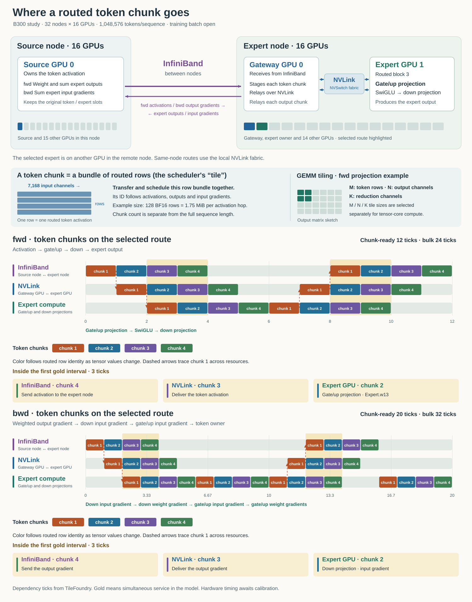
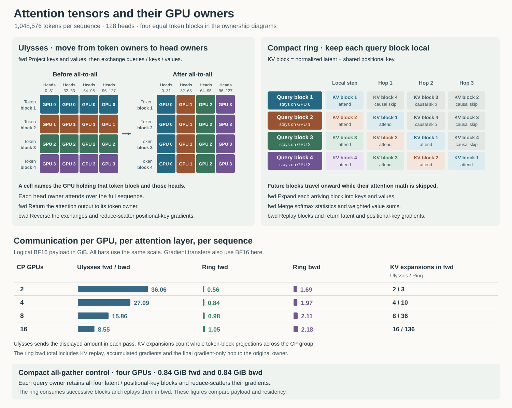
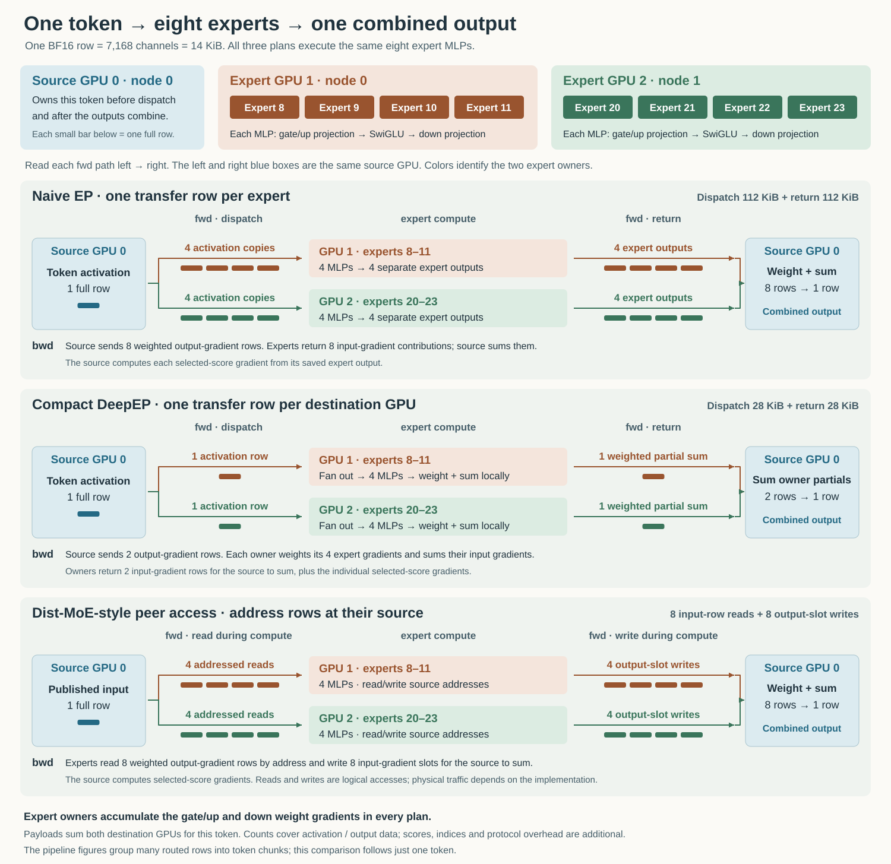
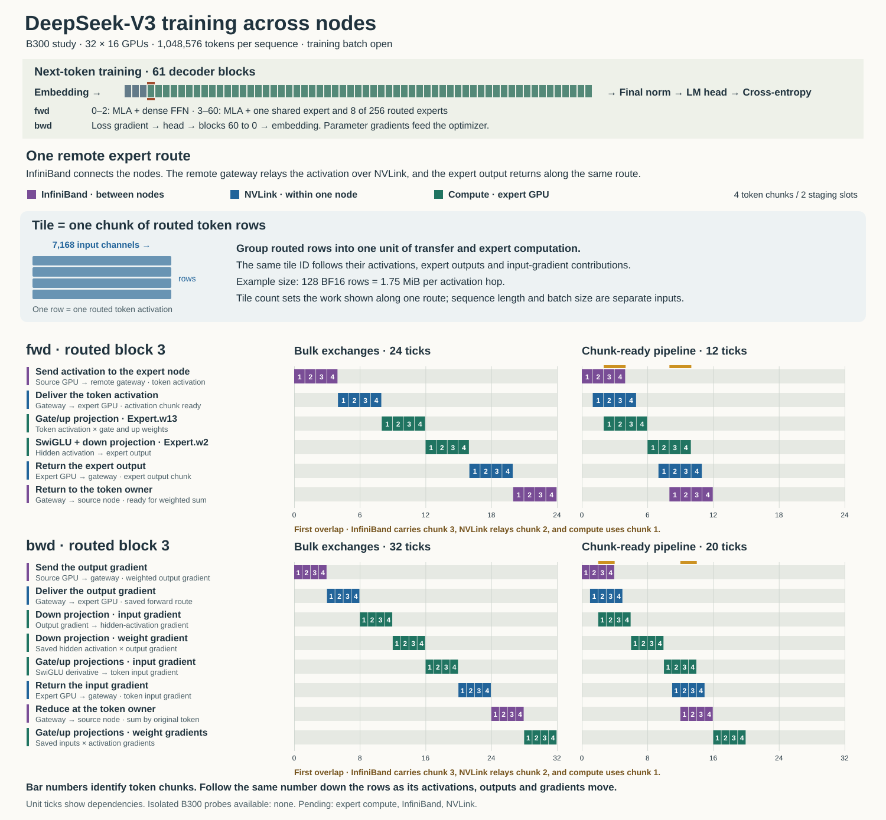

# DeepSeek-V3 training across nodes

This example explores end-to-end optimization of a DeepSeek-V3-style MoE
training subgraph: token ownership and dispatch, expert computation, weighted
combine, backward and gradient delivery. CP, selected FSDP operations and a
companion DualPipe example supply surrounding training constraints. The
optimization objective spans this graph; the analysis, correctness checks and
hardware experiments remain independently callable. Numerical references,
dependency models and an SM103 expert-backward measurement provide the current
evidence; whole-model throughput is a subsequent validation target.



Each training sequence contains **1,048,576 causal tokens**. Global batch size is a separate input. For `sequences_per_update` full sequences, an optimizer update consumes `sequences_per_update × 1,048,576` tokens. The overview uses an illustrative 32 nodes × 16 GPUs and follows the 61 decoder blocks through ordinary next-token loss and backward. It shows three dense FFNs and 58 MoE blocks, each with MLA, one shared expert and eight of 256 routed experts per token. One sequence creates 8,388,608 expert assignments in each routed block. [DeepSeek-V3 model dimensions](https://huggingface.co/deepseek-ai/DeepSeek-V3/blob/main/config.json) · [Training infrastructure](https://arxiv.org/html/2412.19437v2#S3.SS2.SSS2)

The plots use **fwd** for the forward pass and **bwd** for the backward pass. A GPU label identifies the owner, while a token-block or token-chunk label identifies the data. In the attention diagram, the four token blocks each contain 262,144 tokens. Query block 1 stays on GPU 0 in the ring, while the matching compact key/value blocks visit it. The topology diagram follows a representative route from the source GPU to a gateway GPU on another node, then through NVLink to the expert GPU.

| Name in the plots | Value or operation in the executable reference |
|---|---|
| Query block | The local sequence slice of `q` in `context_parallel.py` |
| Compact key/value block | The normalized latent `c` and head-shared positional key `r`, before expansion into per-head keys and values |
| Attention output | The weighted value sum returned by the attention computation |
| Token activation / input gradient | The expert MLP input `x` and the contributions accumulated into `dx` |
| Gate/up projection | `Expert.w13`, which produces the gate, up and hidden activations |
| Down projection / expert output | `Expert.w2`, which maps a hidden activation back to the model width |
| Expert output gradient | The incoming `dy`, weighted per selected expert where required by the dispatch protocol |
| Token chunk | A bundle of routed rows scheduled under one `TileInterval.tile` index; the same index follows its activations, outputs and gradient contributions |

## Compare training layouts



**Ulysses** projects keys and values on token owners, sends packed queries, keys and values to head owners in one all-to-all, and gathers the head-shared positional key. Head owners run full causal attention and return the attention output to token owners. The bwd pass reverses both transposes and reduce-scatters the positional-key gradient over heads. **Ring Attention** keeps queries on their token owners. Each traveling block carries normalized KV latents and the shared positional key. The receiver expands keys and values and updates the row maximum, normalizer and value sum. The bwd pass replays these compact blocks, accumulates query gradients locally and returns the latent and positional-key gradients to their original block owner. This is a compact-MLA adaptation of Ring Attention. [Ulysses paper](https://arxiv.org/abs/2309.14509) · [TorchTitan MLA layouts](https://github.com/pytorch/torchtitan/blob/f782e30c1aaf1965c851abeaa6b73d29d35270b6/torchtitan/models/common/attention/cp_mla.py#L77-L155) · [Ring Attention paper](https://arxiv.org/abs/2310.01889)

The figure counts **logical BF16 data sent by one GPU in a context-parallel group**, for one sequence and one MLA layer. Let `cp_gpus` be the number of GPUs in that group and `tokens_per_gpu = 1,048,576 / cp_gpus`. For Ulysses, each transpose sends a fraction `(cp_gpus−1)/cp_gpus` of its input away. The packed input has `128 × (192+128+128)` channels, the returning output has `128 × 128`, and each local block of the 64-channel shared key reaches `cp_gpus−1` peers. The chosen backward sends the same total with the adjoint collectives. The ring sends a `2 × tokens_per_gpu × (512+64)` byte block for each of `cp_gpus−1` forward hops. Backward sends those KV blocks again and the gradient accumulator takes `cp_gpus` hops, including the last hop home. Both directions use BF16 in this accounting. Future-only blocks skip arithmetic and still circulate. At four ranks this trades 27.09 GiB per direction for 0.84 GiB forward and 1.97 GiB backward, with ten forward block projections across the group versus four. These totals cover CP tensor payloads. Weight-gradient collectives, link protocols and elapsed times require separate accounting.

To separate the effect of compact KV from the choice of collective, the fixture also executes TorchTitan’s **compact all-gather** pattern. At four ranks it sends the same 0.84 GiB forward as the ring. With BF16 gradient reduction and the gathered inputs retained, its backward reduce-scatter also sends 0.84 GiB. Each query rank materializes all four compact blocks. The ring consumes blocks successively and replays them in backward. [TorchTitan compact MLA all-gather](https://github.com/pytorch/torchtitan/blob/f782e30c1aaf1965c851abeaa6b73d29d35270b6/torchtitan/models/common/attention/cp_mla.py#L44-L76)



| EP path | fwd dispatch and combine | bwd gradients |
|---|---|---|
| Naive variable-split all-to-all | Send one row per assignment. Return each expert result to the token owner for weighting. | The token owner sends a weighted output gradient per expert slot, computes selected-score gradients and adds returned input gradients. |
| Compact DeepEP | Send one row per (token, destination rank) with selected IDs and scores. Fan out and reduce within the destination before returning a row. | Reuse the route for the output gradient. Sum input gradients by token at the destination and return the selected-score gradients. |
| Dist-MoE-style peer access | Publish each source row once. The gate/up projection gathers by peer address, and the down projection writes its result to the origin slot. | The source publishes weighted route gradients. Experts read them for input and weight gradients and scatter input gradients back to slots. |

The illustrated token selects four experts on each of two other ranks. Read each fwd path from left to right: the blue input and output boxes are the same source GPU, and the two colored lanes identify the expert owners. Each small bar is one full 7,168-channel row. Naive dispatch sends eight 14 KiB activation rows and returns eight expert outputs for weighting and summation at the source. Compact dispatch sends two rows, fans out to the same eight expert computations and returns two locally weighted sums. The source adds those two partial results. The diagram's payloads sum both destination GPUs, including the same-node destination. Peer reads and writes are counted by address; their physical traffic depends on the implementation and fabric. The peer-address example follows Dist-MoE’s symmetric-memory ownership. The topology figure above models an explicit hierarchy with a gateway and an expert GPU on the remote node. [TorchTitan all-to-all dispatcher](https://github.com/pytorch/torchtitan/blob/f782e30c1aaf1965c851abeaa6b73d29d35270b6/torchtitan/models/common/moe/token_dispatcher.py) · [DeepEP compact dispatch and combine](https://github.com/pytorch/torchtitan/blob/f782e30c1aaf1965c851abeaa6b73d29d35270b6/torchtitan/distributed/deepep/deepep.py#L405-L465) · [Dist-MoE BF16 forward and backward](https://github.com/meta-pytorch/dist_moe/blob/285763b5a0e01059a62c96b0990754a60a6ed94a/docs/bf16_execution.md#L63-L92)

### Run the comparisons

From this directory in an installed TileFoundry environment:

```sh
python context_parallel.py
python expert_parallel.py
python compare.py
python visualize_baselines.py --out-dir .
```

- `context_parallel.py` checks the causal attention output, query gradient, latent gradient, positional-key gradient and both key/value projection weight gradients against dense FP32 autograd. The evaluator runs HIR projection and attention blocks, split-to-split exchanges, the shared-key gather and its backward reduction. The rank driver rotates the ring packets. Inputs begin at the normalized latent and post-RoPE boundary.
- `expert_parallel.py` runs all three plans on identical routes with co-located experts, spread experts and empty owners. It checks the combined expert output, token input gradients, selected-score gradients and every expert weight gradient. HIR evaluates the bounded exchange mailboxes and expert MLP. The driver supplies the fixed top-eight selections, variable record counts and peer addresses.
- `compare.py` composes **all six CP × EP pairs** at an MLA output projection feeding a routed FFN. The same four logical ranks switch from CP to EP after attention returns token ownership. Across four independent data replicas, FSDP gathers shards of the MLA KV projection, keeps the weights available through backward and reduce-scatters its accumulated gradient. Each final gradient shard and each sequence’s output, input and score gradients are checked against one dense loss. The executable uses 12-token sequences and 32 toy experts. The figures use the full-model dimensions for payload arithmetic. The [FSDP/HSDP training example](../fsdp_training/README.md) covers the wider parameter and optimizer lifecycle.

## Reference designs and what is verified

These are reference **designs** whose selected contracts are reproduced by the
examples. Numerical agreement checks the modeled training behavior. Native
library throughput is a separate comparison.

| Reference design | Contract exercised | Verification |
|---|---|---|
| Ulysses and compact MLA Ring Attention | Token/head ownership, causal attention and reverse exchanges | HIR outputs, input gradients and KV projection gradients against dense autograd; compact all-gather controls for the KV representation |
| TorchTitan naive EP and DeepEP-style compact dispatch | Per-assignment rows versus per-destination rows, score weighting and gradient reduction | Identical routes through all three EP references, including co-located experts and empty owners; separate four-GPU PyTorch/NCCL controls for naive and compact exchange |
| Dist-MoE | Published source rows, expert-side pointer gathering, output slots, and hidden-activation scratch reuse in backward | Peer-address HIR output and all gradients; an illegal deferred reader is rejected and a separate-buffer repair passes the lifetime checker |
| DualPipe | Counterflow compute-action groups and deferred weight backward | Four schedule configurations match the pinned official action groups; the four-rank/eight-microbatch HIR case has maximum absolute error `8.94e-8` and five saved-activation slots per rank |
| Selected FSDP projection lifecycle | Gather the MLA KV projection and reduce-scatter its accumulated gradient | All six Ulysses/Ring × naive/compact/peer EP combinations agree with a dense training loss |

Dist-MoE motivates a kernel boundary that can gather remote rows as local
matrix tiles become ready and scatter results at the output boundary. Its BF16
scratch contract also explains why down-projection weight backward must read
the hidden activation before that range is reused. The companion experiment
preserves that activation to permit a different order. It uses cuBLAS,
TileLang and a peer CUDA copy; it does not benchmark the native Dist-MoE kernels.
See the [Dist-MoE execution contract](https://github.com/meta-pytorch/dist_moe/blob/285763b5a0e01059a62c96b0990754a60a6ed94a/docs/bf16_execution.md).

DualPipe supplies a larger consumer of such a boundary: the preceding pipeline
stage needs input gradients before this stage necessarily needs to finish all
weight gradients. The adapter checks that saved activations survive those
deferred readers. It serializes compute within an upstream paired group and
uses dependency ticks, so this is a schedule/gradient/lifetime check rather
than a full distributed DualPipe performance reproduction. The checked
`(ranks, microbatches)` pairs are `(2, 4)`, `(4, 8)`, `(4, 12)` and `(8, 20)`.
[Official DualPipe schedule](https://github.com/deepseek-ai/DualPipe/blob/030ce4325f4ebeb437da4ebc6d00a70469dd58ae/dualpipe/dualpipe.py).

## From modeling to optimization decisions

The useful optimization unit can span tensor representation, ownership,
communication, several kernels and their consumers. A developer or agent can
call each example independently, retain its outputs, and revisit a decision
when another stage supplies new evidence. No optimization controller is required.

| Decision | Result available from these examples | Design guidance |
|---|---|---|
| What should CP communicate? | At four GPUs, Ulysses sends 27.09 GiB per GPU in each pass; compact ring sends 0.84 GiB fwd and 1.97 GiB bwd. Compact all-gather also sends 0.84 GiB fwd and 0.84 GiB bwd. | Compare compact representation separately from collective choice. Ring trades successive blocks and replay against all-gather residency; it is not automatically the faster choice. |
| Where should expert rows be grouped? | For the illustrated token, eight assignments on two remote GPUs become two destination rows: 112 KiB → 28 KiB for dispatch, and the same reduction for return. The expert computations are unchanged. | Inspect routing locality and row imbalance before tuning grouped GEMM. Peer addressing alone does not prove that eight addressed reads cause only one physical transfer. |
| When can compute consume a chunk? | The bounded route sweep below reaches its best tested dependency schedule at two slots. | Make chunk readiness and consumer completion explicit at the communication/kernel interface; extra buffering needs evidence of benefit. |
| Which backward result should arrive first? | The SM103 experiment returns 2,048-row input gradients 34.81 microseconds earlier, with 8 MiB extra live storage and 4.07 microseconds later local completion. | Evaluate the preceding stage's dependency window and memory budget, as well as individual kernel time. |

`guidance.py` reuses `workload.cp_payload`, the same route fixture as the EP
reference, and TileFoundry's `tile_pipeline`. It emits the arithmetic, schedule
sweep and evidence units as JSON. Supplying a saved backward report adds an
independent sensitivity calculation; it does not launch GPU kernels or train a
model.

```sh
python guidance.py --out /tmp/training-guidance.json
python guidance.py --cp-gpus 8 --chunks 16 --slots 1 2 4 --out /tmp/larger-route.json
python guidance.py --backward-report ../distributed_training_overlap/results/sm103.json \
  --upstream-work-us 0 32 80 --out /tmp/dependency-window.json
```

### Chunk readiness and buffer capacity

The default sweep schedules eight 128-row chunks through the same fwd/bwd
phases used in the diagrams. Every operation has duration **one dependency
tick**. IB, NVLink and compute each have one serial resource; the authored
gate/up, down and weight-gradient phase boundaries remain in place.

| Service order | Slots per staged edge | fwd completion | bwd completion | BF16 wire buffer per edge |
|---|---:|---:|---:|---:|
| Bulk, materialize every stage | 8 | 48 ticks | 64 ticks | 14 MiB |
| Chunk-ready | 1 | 34 ticks | 50 ticks | 1.75 MiB |
| Chunk-ready | 2 | 20 ticks | 36 ticks | 3.5 MiB |
| Chunk-ready | 3 | 20 ticks | 36 ticks | 5.25 MiB |
| Chunk-ready | 4 | 20 ticks | 36 ticks | 7 MiB |

Work does not disappear: IB and NVLink each serve 16 ticks in both passes;
compute serves 16 ticks in fwd and 32 in bwd. Readiness removes stage-wide
waiting, and a slot stays occupied until its consumer finishes. Two slots are
the smallest tested capacity at the best completion time under these
assumptions. The buffer column is `slots × 128 × 7168 × 2` bytes for **one
wire edge**, not total training memory or a compiled kernel's shared memory.

This suggests testing a double-buffered chunk interface before increasing
capacity. Replace equal ticks with matched compute, NVLink and IB probes to
revisit that choice:

```sh
python guidance.py --rows 128 --samples measurements/compute.json \
  measurements/nvlink.json measurements/ib.json --out /tmp/calibrated-guidance.json
```

A complete probe set changes the schedule unit to **modeled microseconds**.
With a missing probe, all stages stay in dependency ticks and the report names
the missing evidence. Observed overlap still needs a common-clock activity
trace; isolated medians do not capture shared-fabric or compute contention.

### Feed kernel-suite measurements back into a training dependency

The companion SM103 experiment measures input-gradient delivery and all-backward
completion separately. For 2,048 routed rows, their medians are respectively
`208.38 / 233.50` microseconds for the baseline and `173.57 / 237.57` for
preserve-and-defer. Both use identical GEMMs and activation derivatives.

Consider an explicitly hypothetical predecessor that can start independent
work immediately when the gradient arrives. A two-branch completion estimate is
`max(delivery + predecessor work, local backward completion)`:

| Assumed predecessor work | Baseline completion from medians | Preserve-and-defer completion from medians |
|---|---:|---:|
| 0 microseconds | 233.50 microseconds | 237.57 microseconds |
| 32 microseconds | 240.38 microseconds | 237.57 microseconds |
| 80 microseconds | 288.38 microseconds | 253.57 microseconds |

The preferred order changes with the consumer. These are sensitivity results
derived from the saved medians, not measured training-step times or completion
quantiles. They assume an available preceding stage, no new contention and no
other dependencies. A full application must also retain the per-expert row
distribution, parameter gathers/reductions, activation retention and memory
budgets. Multiplying the measured improvement by 58 MoE blocks would ignore
those dependencies.

### Independent handovers

| Producer | Reusable output | Consumer and acceptance check |
|---|---|---|
| CP/EP/FSDP numerical references | Tensor ownership, routing and expected outputs/gradients | A layout or communication implementation must preserve the same training result. |
| Payload and route analysis | Bytes, per-expert rows, chunk geometry, stage intervals and evidence units | An implementation author chooses packing, readiness granularity and buffer capacity to test. |
| Lifetime analysis and DualPipe adapter | Last readers, safe reuse, split-backward order and saved activation slots | A proposed fusion or reordering must retain every consumer's input. |
| External GPU implementation | Correctness results, delivery/completion samples and extra live bytes | The training model revisits the critical dependency and measures the next missing stage. |

For example, a compact-EP candidate changes packing and local fan-in, then
passes the same output/input/score/weight-gradient checks. A chunk-ready
candidate changes buffer ownership and completion signaling, then needs its
own activity trace. A deferred-backward candidate changes storage and order,
then returns two completion events to the application. These are separate
decisions that can compose. The examples demonstrate the interfaces and local
evidence; a measured comparison of whole-model candidate selection and search
cost remains a subsequent experiment.

## Generate the topology and pipeline



A **tile**, labeled **token chunk** in the plots, is a bundle of routed rows transferred and scheduled together. Routing can place nonadjacent tokens together and assign the same token to multiple experts. For example, 128 BF16 activation rows at width 7,168 carry 1.75 MiB on each illustrated hop. A tile's hidden activations have width 2,048; its expert outputs and input gradients return to width 7,168. The tile ID tracks the routed row group as its tensor values and shapes change through the computation.

From this directory in an installed TileFoundry environment:

```sh
python visualize_topology.py --out topology.svg
python visualize.py --out pipeline.svg
python visualize.py --layer 60 --tiles 8 --slots 3 --nodes 128 --sequences 8 --out /tmp/layer60.svg
python reference.py
```

`--tiles` sets the number of token chunks shown along the route; it does not partition the full sequence into that many pieces. Benchmark `--rows` sets the rows per measured chunk, and the renderer reads that size from the samples. With neither samples nor a capture, the guide's size is illustrative and the timeline uses dependency ticks.

In `topology.svg`, each token chunk keeps its color across InfiniBand, NVLink and compute. Dashed arrows follow chunk 1 through successive resources. The three cards below each timeline identify the operations active together at the midpoint of the first gold interval. Both the timelines and these snapshots come from the same TileFoundry intervals. The headers also report the bulk schedule with the same stage durations. The two nodes illustrate one remote route within the selected larger cluster.

The detailed `pipeline.svg` expands each named graph operation into its own row. A bar's number identifies the same token chunk across rows. Gold marks simultaneous service on the three resources. Bulk execution materializes each stage. Chunk-ready execution (`tile_ready` in the API) passes a chunk onward after its producer finishes and retains a staging slot until its consumer finishes. Both schedules fence the gate/up and down kernel phases. The fwd schedule applies SwiGLU in the down phase, and bwd separates input and weight gradients. Each fabric and the compute lane are modeled as one serial resource. Route discovery, shared-expert work, top-k fan-in, context-parallel attention and parameter-gradient collectives occur outside the expanded timing window.

With the default options the report prints tokens and assignments per sequence. Supplying `--sequences sequences_per_update` also prints tokens per optimizer update. Node count and batch size can vary independently. The FP32 reference checks both service orders through the source, gateway and expert `Reshard` operations, including an empty expert node and the sum of expert-owner contributions to the token input gradient.

## Measure the B300 stages

The benchmark takes its target identity from CUDA compute capability **10.3**. It records the driver-reported name and UUID separately. Use the same row count, BF16 wire format, hidden width 7,168 and expert width 2,048 for all probes. Compute samples time warm PyTorch BF16 projections and their explicit backward operations. Link samples time one-way NCCL transfers in each direction on the receiver's CUDA stream. A two-GPU local run verifies an NVLink topology and NCCL P2P channel. An IB run requires different physical nodes, an active InfiniBand port on each, and a confirmed NCCL IB channel. [NVIDIA device capabilities](https://developer.nvidia.com/cuda/gpus)

```sh
python benchmark.py compute --rows 128 --out measurements/compute.json
torchrun --standalone --nproc-per-node 2 benchmark.py nvlink --rows 128 --out measurements/nvlink.json
```

Run the following on **both** IB-connected nodes with the same rendezvous address. Set `NODE_RANK` to 0 or 1 and `HCA` to the local device and port. Rank 0 writes the result.

```sh
torchrun --nnodes 2 --node-rank "$NODE_RANK" --nproc-per-node 1 \
  --master-addr "$MASTER_ADDR" --master-port 29500 \
  benchmark.py ib --hca "$HCA" --rows 128 --out measurements/ib.json
python visualize.py --samples measurements/*.json --out /tmp/calibrated.svg
python visualize_topology.py --samples measurements/*.json --out /tmp/topology-calibrated.svg
```

Each row displays its available isolated median. The bars use dependency ticks until all three probes are available. A complete set switches both columns to **modeled microseconds** from isolated medians. The BF16 reference charges one payload per illustrated hop. Compact dispatch, FP8 wire formats and fused distributed GEMMs need measurements of their own. [Dist-MoE training kernel stages](https://github.com/meta-pytorch/dist_moe/blob/285763b5a0e01059a62c96b0990754a60a6ed94a/docs/mxfp8_kernel_design.md#L97-L128)

Both pipeline renderers accept `--samples` for isolated durations and `--trace capture.json` for **observed** overlap. Set `schema` to 1, `cc` to `[10,3]`, `tiles` and `slots` to the selected geometry, and record the raw capture `source`, common `clock_domain` and worst-case timestamp error `clock_error_us`. Under `passes.Forward` and `passes.Backward`, provide `bulk` and `tile_ready` arrays of `[action_key, zero_based_tile, start_us, end_us]`, where `zero_based_tile` identifies the token chunk. The action keys are in `workload.py`. Use per-role device activity/completion intervals on a common calibrated time base. A kernel launch envelope cannot identify which roles ran together. The renderer checks chunk readiness and trims the gold intervals by the clock uncertainty at each end.
