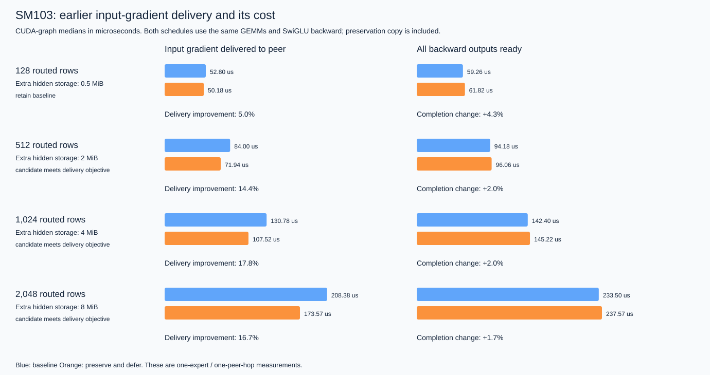

# Deferring an expert weight gradient safely

The application question is whether an expert can return its input gradient
earlier while deferring part of weight backward. The example exercises three
independent interfaces: HIR function evaluation, explicit physical-buffer
lifetimes, and a CUDA implementation with measured completion events.

## From the storage contract to a candidate

For one routed expert, let `h = SiLU(x @ W_gate) * (x @ W_up)` and
`y = h @ W_down`. Computing `dW_down = h.T @ dy` needs the forward hidden
activation. Dist-MoE's BF16 implementation reuses that activation's scratch
range for the gate/up activation gradient, so its weight-gradient reader must
finish before the overwrite. See the
[backward buffer contract](https://github.com/meta-pytorch/dist_moe/blob/main/docs/bf16_execution.md#backward).

`lifetime.py` supplies those producer/consumer intervals to
`check_buffer_lifetimes`. Simply moving `dW_down` later triggers
`overwrite_live_value`. Preserving `h` in separate storage makes the candidate
legal, while keeping the gate/up gradient live through its own weight backward.
This is an explicit trace check: the application supplies accesses and timing.

| Schedule | Compute order | Peer transfer |
|---|---|---|
| Baseline | Down input gradient → down weight gradient → SwiGLU backward → gate/up input gradient → gate/up weight gradient | Starts after the gate/up input gradient |
| Preserve and defer | Preserve hidden activation → down input gradient → SwiGLU backward → gate/up input gradient → down weight gradient → gate/up weight gradient | Starts after the gate/up input gradient |

The new candidate spends `rows × 2048 × 2` extra bytes to move the down weight
gradient off the input-gradient delivery path. Both schedules can overlap peer
transfer with weight computation. Both use the same GEMMs and the same TileLang
SwiGLU backward kernel; the preservation copy is included in candidate timing.
This experiment changes the kernel suite's ordering and storage, not the
expert's differentiation formula.

## A small training application

`dualpipe_schedule.py` projects the official DualPipe compute-action groups,
including counterflow and deferred weight backward. `dualpipe.py` supplies
explicit PP transfer dependencies and replays the resulting order through
three HIR functions: `forward`, `input_gradient`, and `weight_gradient`.

The default example has four PP ranks, eight microbatches, and two counterflow
parameter replicas. Each logical stage is a residual FFN with one shared and
four routed experts, with two selected per token. Fixed routes keep the
experiment focused on the schedule and backward dependencies. Replica weight
gradients are summed and compared against a dense PyTorch autograd reference.
The saved-activation checker retains each slot through its last weight reader
and rejects a deliberately premature reuse after input backward.

For four ranks and eight microbatches, the maximum absolute numerical error
was `8.94e-8`, with five saved-activation slots per rank. Two-rank/four-microbatch
and four-rank/twelve-microbatch cases also passed. A local comparison matched
the official compute-action groups for `(ranks, microbatches)` equal to
`(2, 4)`, `(4, 8)`, `(4, 12)`, and `(8, 20)`, against
[DualPipe's pinned implementation](https://github.com/deepseek-ai/DualPipe/blob/030ce4325f4ebeb437da4ebc6d00a70469dd58ae/dualpipe/dualpipe.py).

Durations in that example are dependency ticks. Compute within a paired group
is serialized; PP sends can overlap it. This establishes a working schedule
adapter and numerical/lifetime checks, without treating the diagram as a
DualPipe throughput prediction.

## Measurement on SM103

The recorded run uses two SM103 GPUs with an `NV18` peer connection, PyTorch
`2.14.1+cu132`, CUDA `13.2`, and TileLang `0.1.15`. Each case is one expert's BF16
backward with hidden width 7,168 and expert width 2,048. A routed row is one
token's contribution to this expert. The peer receives the input-gradient
matrix; this is one communication boundary, not a distributed expert dispatch.

The harness preallocates inputs/outputs, restores the same forward-produced
scratch contents before each timed iteration, warms both paths, and alternates
their order for 51 samples. CUDA graphs remove Python submission delays from
the comparison. A peer-address `cudaMemcpyAsync` runs on a separate source-GPU
stream with explicit producer and completion events. Timing events share that
GPU's clock.

Extra storage counts the candidate's required live hidden buffer. The shared
harness preallocates it so allocation is outside both timing intervals.

- **Input-gradient delivery** ends when the peer copy completes.
- **Backward completion** is the later of peer-copy completion and the last
  weight-gradient completion.
- **Graph-join completion** is recorded separately from those work completions.

An initial eager-copy harness produced unstable submission/synchronization
overhead and was rejected as timing evidence. Captured graphs and a separate
work-completion event resolved that measurement issue. The activity trace
shows the peer copy overlapping weight-gradient GEMMs; the compute kernels
include the SM103 tensor-core implementations selected by cuBLAS.

The candidate objective is at least 10% earlier median input-gradient delivery,
at most 10% later median backward completion, and candidate delivery P90 below
baseline P10. The percentile check describes this sample set; it is not a
confidence interval or a guarantee for a different workload.

Medians from the recorded run (51 samples per schedule; times in microseconds):

| Routed rows | Delivery: baseline → candidate | Backward completion: baseline → candidate | Extra storage | Decision for this run |
|---|---|---|---|---|
| 128 | 52.80 → 50.18 | 59.26 → 61.82 | 0.5 MiB | Retain baseline |
| 512 | 84.00 → 71.94 | 94.18 → 96.06 | 2 MiB | Meets objective |
| 1,024 | 130.78 → 107.52 | 142.40 → 145.22 | 4 MiB | Meets objective |
| 2,048 | 208.38 → 173.57 | 233.50 → 237.57 | 8 MiB | Meets objective |

The larger case demonstrates why both completion events matter: earlier input
gradients may unblock the preceding pipeline stage even when local backward
finishes slightly later. Whether this improves a complete training step depends
on its critical path and memory budget. Smaller cases changed admission between
exploratory runs; choose a schedule per workload after measurement.

## Reproducing the evidence

Use the commands in [README.md](README.md). `benchmark.py` checks input and both
weight gradients against autograd, exact peer delivery, repeated execution,
and tail shapes `(7, 64, 32)` and `(129, 256, 128)` before timing the model-width
cases. It validates both eager and captured execution. BF16 comparisons use
`atol=0.004, rtol=0.016`; recorded maximum errors are in the JSON report.

The committed `results/sm103.json` retains measurement summaries, numerical
checks, topology, software versions and source hashes. A new run writes every
sample as well, exports the last kernel specialization beside the JSON as
`.cu`, and optionally exports a Chrome activity trace with `--trace`.
`visualize.py` renders the JSON reports to SVG.

The exported TileLang CUDA kernels also passed Compute Sanitizer memcheck at
`(rows, expert width) = (7, 32), (129, 128), (128, 2048)`, with zero reported
errors. A standalone C++ harness exercised one eager launch and three graph
replays per specialization. This check covered the custom kernel; numerical
checks above covered the complete GEMM/activation/peer-copy schedules.

These interfaces let an application supply its own schedule and storage
mapping, reject unsafe reuse, check the training equations, and measure a legal
kernel-suite candidate. The existing DeepSeek-V3 example supplies the larger
architecture and CP/EP comparisons. Integrating measured NVLink/IB service and
the full-model critical path is a separate application of the same records.
