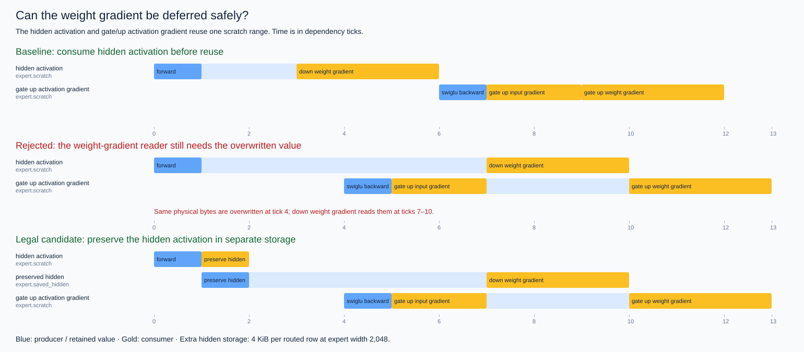
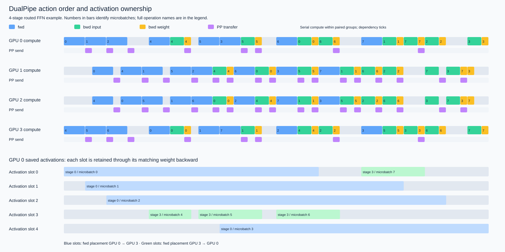

# Distributed training overlap interfaces

Three standalone applications exercise TileFoundry's interfaces using a
DeepSeek-V3-style routed FFN: checking physical buffer reuse, replaying a small
DualPipe schedule through HIR, and measuring a lifetime-guided backward schedule
on two SM103 GPUs. The larger architecture and CP/EP comparisons are in the
[DeepSeek-V3 training example](../deepseek_v3_training/README.md).

| Application | Interface exercised | Result |
|---|---|---|
| `lifetime.py` | `BufferLifetime`, `BufferAccess`, `check_buffer_lifetimes` | Legal scratch reuse, a rejected deferred reader, and a separate-buffer repair |
| `dualpipe.py` | HIR `check_program` / `evaluate`, plus explicit lifetimes | Forward values, split backward, replica-gradient sums and activation-slot ownership |
| `benchmark.py` | Explicit storage contract plus an external TileLang/CUDA implementation | Input-gradient delivery and backward-output readiness on NVLink peers |

## CPU examples

Run from this directory in an installed checkout of this branch:

```sh
python lifetime.py --out results/lifetime.json
python dualpipe.py --ranks 4 --microbatches 8 --out results/dualpipe.json
python visualize.py --out-dir results
```

The lifetime example follows Dist-MoE's BF16 reuse of the hidden-activation
range for the gate/up activation gradient. Deferring the down-projection weight
gradient while retaining that alias is rejected. Copying the hidden activation
to a separate allocation makes the candidate legal. Transfer consumers remain
live until completion. [Dist-MoE backward contract](https://github.com/meta-pytorch/dist_moe/blob/main/docs/bf16_execution.md#backward)

The DualPipe adapter projects the official eight-step algorithm into compute
groups. The example keeps compute serial within each paired group and inserts
explicit PP transfers; durations are dependency ticks. Four logical PP ranks
process eight microbatches in both directions, with two parameter replicas.
Each stage evaluates a residual FFN with one shared and four routed experts,
two selected per token. An independent PyTorch graph checks final outputs,
input gradients and every weight gradient after summing replica contributions.
Routing selections and scores are fixed inputs.



Saved activation slots remain owned until weight backward finishes. The report
includes the slot assignment and a deliberately premature reuse that the
checker rejects. This is a numerical and lifetime example; it does not estimate
full-model throughput or execute a distributed PP runtime.
[DualPipe source](https://github.com/deepseek-ai/DualPipe/blob/030ce4325f4ebeb437da4ebc6d00a70469dd58ae/dualpipe/dualpipe.py)
· [Dist-MoE pipeline slots](https://github.com/meta-pytorch/dist_moe/blob/main/docs/pipeline_activation_slots.md)



## SM103 experiment

The GPU example requires PyTorch with CUDA, TileLang, `cuda-python` runtime
bindings and two peer-accessible SM103 GPUs connected through NVLink. Set
`CUDA_VISIBLE_DEVICES` to the intended pair and inspect `nvidia-smi topo -m`.

```sh
CUDA_VISIBLE_DEVICES=0,1 OMP_NUM_THREADS=1 python benchmark.py \
  --rows 128 512 1024 2048 --repeats 51 --out results/sm103.json \
  --trace results/sm103-trace.json
python visualize.py --out-dir results
```

Both schedules use the same BF16 tensor-core GEMMs and TileLang SwiGLU backward.
The candidate preserves the hidden activation, computes the input gradient
first, and returns it to the other GPU while weight-gradient GEMMs run. The
preservation copy is timed. An explicit peer-address CUDA copy on a separate
stream supplies the communication boundary; the experiment executes one expert
backward and one peer hop.

The benchmark checks all gradients against autograd, exact peer delivery,
tail shapes and repeated calls before timing captured CUDA graphs. Inputs and
outputs are preallocated, and the same forward-produced scratch contents are
restored outside each timing interval. Runs alternate baseline/candidate order
with warm data reuse. All timing events use the source GPU's clock.

`input_gradient_delivery_us` ends after the peer copy. `backward_completion_us`
is the later of peer-copy completion and the last weight-gradient completion.
`joined_graph_completion_us` records the subsequent graph join separately.
Raw samples, source hashes, numerical errors and the activity trace accompany
the results. The experiment's objective is earlier input-gradient delivery
with at most 10% regression in backward-output readiness.

See [the experiment record](EXPERIMENT.md) for the observed result and its
measurement process. Inter-node IB service and full-model schedules can be
supplied by future applications of these interfaces.
