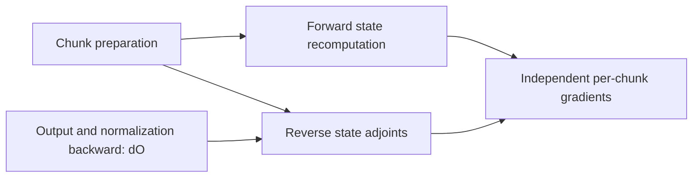

# Incomplete example: full Qwen3.5 GDN at 8k: mixed precision and fusion interfaces

**Status: incomplete.** The 8k BF16 example retains strict parameter-gradient
mismatches and has not been lowered to executable GPU kernels. See [README.md](README.md)
for the current status and [BF16_8K.md](BF16_8K.md) for the numerical evidence.

The complete layer runs at 8,192 tokens in TileFoundry HIR, both as one joint
forward/backward program and as a fixed partition of callable regions. The two
executions are bitwise identical for the output, hidden gradient, and all nine
parameter gradients. **Strict numerical comparison with independent autograd is
not fully clean: the QKV projection weight gradient retains an elementwise
mismatch.** The original failures and thresholds are preserved, not converted
into a success by increasing tolerances.

This work prepares representations, interfaces, and validation tools. No plan
solver, optimal-plan search, GPU benchmark, or CUDA fusion experiment was run.

## Configuration and precision contract

The test uses the actual Qwen3.5-397B-A17B GDN dimensions: hidden width 4,096,
16 Q/K heads, 64 value heads, key/value widths 128, a four-tap causal depthwise
convolution, batch one, and 8,192 tokens in 128 chunks of 64. Weights are
synthetic, with weak decay for sensitivity to carried state. The final two input
positions are masked. Pretrained checkpoint weights are not loaded.

| Component | Explicit precision |
|---|---|
| Hidden input, projection/convolution compute weights and activation storage | BF16 |
| Projection contractions and convolution tap accumulation | FP32, followed by explicit BF16 rounding |
| Q/K normalization, chunk-core arithmetic, recurrent state, decay parameters | FP32 |
| Gated RMSNorm | FP32 reduction and arithmetic, with the Qwen BF16 core-output, normalized-output, and gated-output boundaries retained |
| A_log, dt_bias, normalization weights | FP32 |
| All nine parameter-gradient outputs | FP32 |
| Hidden-state gradient | BF16, after FP32 branch accumulation |

The chunk core follows the pinned fallback's FP32 arithmetic. This is not a
claim to reproduce the internal BF16 tensor-core rounding of production fused
FLA kernels. Likewise, FP32 parameter-gradient outputs are intended for master
gradient accumulation; no optimizer step is included.

The reference uses FP32 master leaves containing exactly the BF16 compute-weight
values. It performs FP32 contractions, preserves BF16 activation rounding, and
accumulates shared-Q/K adjoints in FP32 before narrowing. This avoids silently
making PyTorch's BF16 leaf-gradient buffers the accumulation specification.
The unchanged official BF16 module is also compared separately, since its
parameter-gradient storage and some shared-head rounding differ.

## What the verification establishes

All forward and backward functions of the whole program and the candidate
partition pass native `check_program` and execute through the CPU HIR evaluator.
The full-size checks cover every element of the output and all ten gradients:
hidden states plus the nine parameter tensors. Nothing is checked only by
sampling a few parameter entries.

The independent reference uses PyTorch autograd, standard convolution, and the
pinned official triangular-solve chunk implementation. Every gradient passes
the normwise limit, but three projection-weight tensors fail the stricter
elementwise condition: `in_proj_qkv.weight`, `in_proj_z.weight`, and
`out_proj.weight`. Their largest relative L2 error is approximately `2.9e-4`;
the largest across all parameter tensors is below `1e-3`.

A separate forward-only native HIR oracle differentiates the forward with
PyTorch, without reusing any candidate backward expression. It retains BF16
rounding while using FP32 master leaves and FP32 gradient fan-in. Its forward
output is exactly equal to the candidate's. Eight of nine parameter-gradient
tensors pass the original strict conditions; QKV remains outside the elementwise
condition, with relative L2 error about `1.28e-4`.

The diagnostic traces the remaining discrepancy:

- The incoming gradient to gated normalization is bitwise identical.
- The FP32 core-output gradient produced by RMS backward differs by about
  `6.7e-8` in relative L2. Narrowing changes 2,261 BF16 values out of 67,108,864.
- Differences propagate through the core and convolution to the BF16 QKV
  projection cotangent.
- Recomputing `dW = dQKV.T @ X` from each implementation's own cotangent
  reproduces each weight gradient exactly. The difference between these two
  contractions exactly accounts for the observed QKV weight-gradient difference.

This identifies upstream gradient rounding sensitivity rather than a defect
in the QKV weight-gradient contraction. It does not make the original strict
equivalence check pass. A future search must define whether it preserves these
rounding details or permits a specified numerical error envelope.

The original per-tensor criteria are unchanged: all values finite, relative L2
error at most `0.005`, and elementwise `rtol=0.02` with
`atol=0.002 * max(reference_RMS, 1)`. Every per-tensor metric and verdict remains
in the JSON evidence. All 149 regression tests pass. The suite additionally checks independent
token recurrence, all parameter gradients, exact HIR/DAG agreement, dtype
accounting, FP32 accumulator retention, and partition equivalence.

## Candidate fusion boundaries

The region annotations describe supplied algorithm stages. The tool derives
actual edges, typed inputs/outputs, reductions, BF16 casts, and carried states
from the selected graph, checks that the partition is acyclic, and emits each
region as callable native HIR. It does not discover arbitrary fusions or prove
that a region fits a GPU kernel. A logical dependency boundary need not be a
separate kernel launch.

| Candidate grouping | Why it is useful | Constraint a future fusion planner must preserve |
|---|---|---|
| Beta projection + sigmoid; decay projection + softplus/exp | Pointwise transforms can consume completed projection accumulators immediately. | The hidden-dimension contraction must finish before the nonlinear transform. Preserve the BF16 projection rounding. The QKV, z, beta and decay projections also share X, making a combined projection a separate candidate. |
| Causal convolution + SiLU + Q/K normalization | Avoid materializing several short-lived activations around a token/head. | A token tile needs a three-token convolution halo. Normalization needs all 128 key features. Preserve convolution and activation rounding; sharing Q/K across four value heads should not silently duplicate work. |
| Chunk-local preparation | Prefix decay, Gram products, triangular-system preparation, transformed values and transformed keys can be grouped per chunk/head. | These computations are independent across chunks. The triangular system has intra-chunk dependencies, and the full workspace still needs resource checks. Fusing all preparation into the sequential state loop trades away this independent work. |
| State update + chunk output, optionally row normalization/gating | A persistent implementation could reuse the FP32 state and chunk-local data. | The state is carried between chunks. One full 128-by-128 state is 64 KiB per value head, before workspace. Fusion with row normalization also requires all value features for each row. This is a resource/tiling question, not a proven kernel. |
| Core output rounding + gated RMSNorm + z gate | A per-head row owns the 128-wide reduction and following pointwise operations. | Keep the BF16 output and normalized-value rounding. The output projection contracts across all 8,192 value features, so it has a different tiling/reduction structure. A GEMM prologue is possible, but not established here. |
| Backward pointwise VJPs + local gradient contributions | Normalization/gate derivatives can feed projection or convolution gradients without extra stores. | Shared Q/K contributions must sum across the four value heads in FP32. Parameter gradients also reduce across tokens, and normalization-weight gradients across heads. Local partial gradients need a final FP32 reduction or an explicit accumulation scheme. |

The largest conceptual split is **parallel preparation versus carried state**.
It exposes a choice between preparing many chunks concurrently and streaming
preparation inside a persistent state loop. The graph provides both the data
dependencies and the sizes of the values crossing that choice; it does not rank
the alternatives.

Another useful split appears in backward under this fixed residual policy.
Because core outputs are retained, the normalization backward can provide dO
without first reconstructing every forward state. The dependency extractor
confirms this structure:



Forward state recomputation and reverse state adjoints can therefore be
scheduled independently before their join. This is a scheduling opportunity;
overlap on a GPU has not been measured. Aggressively fusing both into one region
could remove that opportunity.

Fusion also does not erase training dependencies. Convolution weight gradients
need the projected QKV inputs, and SiLU backward needs its preactivation.
Retaining only the post-SiLU activation does not eliminate the need to regenerate
those inputs. The complete joint graph exposes these dependencies to a future
save/recompute search.

## Tools added

- Typed BF16/F32 graph inputs, casts, residual byte accounting, and native
  `tf.matmul(..., out_dtype='f32')` emission. The graph evaluator enforces mixed
  dtypes automatically. A regression catches accidental BF16 rounding of an
  FP32 accumulator.
- Explicit mixed-precision forward and supplied backward formulas for the
  complete layer, with FP32 parameter-gradient outputs.
- Region-interface extraction, an acyclic-partition check, callable HIR region
  emission, and execution with only declared boundary tensors available.
- Independent full-layer autograd references, a forward-only native VJP oracle,
  BF16 boundary comparison, and gradient-rounding attribution.

The selected residual policy retains 579 MiB across forward/backward. This is
one fixed demonstration policy, not a recommendation. It excludes weights,
inputs, gradients, ordinary outputs, and temporary region-boundary tensors.
The interface report gives logical tensor extents; views may alias, so these
counts are not physical traffic or total peak memory.

The existing native call-label identity patch remains applied. No new upstream
TileFoundry operation was required. Hardware target annotations remain H200
while execution is CPU-based; no L20D or H200 runtime performance claim is made.

## Reproduce and inspect

```bash
cd examples/tensor_program_synthesis
bash run_bf16_8k.sh
# Strict cross-reference mismatches currently make the command exit nonzero.
# Run the additional diagnostics independently:
OMP_NUM_THREADS=8 python -u -m synthesis.mixed_vjp_audit
OMP_NUM_THREADS=8 python -u -m synthesis.native_vjp_oracle
OMP_NUM_THREADS=8 python -u -m synthesis.gradient_rounding_audit
```

The VJP comparisons also retain nonzero exit status while their strict condition
fails. Do not treat the absence of `complete.txt` as an interrupted execution;
inspect the execution records in `summary.json` and their per-tensor verdicts.
The checked-in [evidence](evidence/README.md) preserves the completed run, and
[STATUS.json](STATUS.json) records its unresolved status.

Source: `synthesis/full_layer.py`, `mixed_precision.py`, `fusion_boundaries.py`,
`mixed_layer_run.py`, `native_vjp_oracle.py`, and the two diagnostic modules.
Evidence: `results/full_gdn_bf16_8k/summary.json`, `fusion_boundaries.json`,
`native_vjp_oracle.json`, `vjp_audit.json`, `gradient_rounding_audit.json`,
`tests.xml`, and `generated/`.

The exact official configuration and implementation revisions are archived in
`references/qwen35/sources.json`. The implementation source is
[Transformers fd3cf014](https://github.com/huggingface/transformers/blob/fd3cf0140de03f7619ac95b5cfed05b711ff9e22/src/transformers/models/qwen3_5/modeling_qwen3_5.py),
with dispatch decorators removed for the pure-PyTorch reference.
